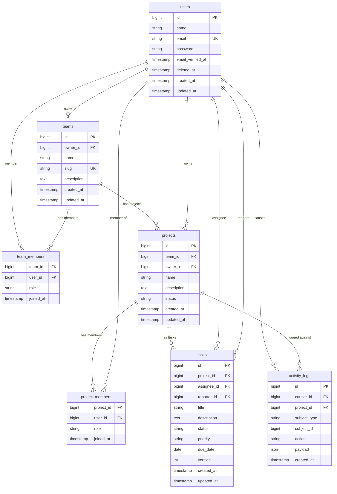

# Entity Relationship Diagram

Generated from Laravel migrations in `backend/database/migrations/`.

## Enum values

| Table | Column | Allowed values |
|---|---|---|
| `team_members` | `role` | `owner`, `admin`, `member` |
| `project_members` | `role` | `manager`, `member`, `viewer` |
| `projects` | `status` | `active`, `archived`, `completed` |
| `tasks` | `status` | `todo`, `in_progress`, `in_review`, `done` |
| `tasks` | `priority` | `low`, `medium`, `high`, `urgent` |

## Design notes

- **`team_members`**: composite unique on `(team_id, user_id)`; `role` controls permissions within the team
- **`project_members`**: composite unique on `(project_id, user_id)`; project access is scoped to team membership, not direct invite
- **`tasks.version`**: used for optimistic concurrency. `UPDATE` only succeeds when `WHERE id = ? AND version = ?`, then atomically increments. Returns 409 on mismatch. See [ADR 004](../adr/004-optimistic-concurrency.md)
- **`tasks.assignee_id`**: nullable with `nullOnDelete`; reassigned to null if the user is removed rather than cascading a delete
- **`activity_logs`**: polymorphic subject via `subject_type` + `subject_id` covers teams, projects, and tasks from a single append-only table. See [ADR 006](../adr/006-activity-log-denormalization.md)
- **`activity_logs.project_id`**: denormalised FK enabling fast per-project feed queries without a join through `subject_type`
